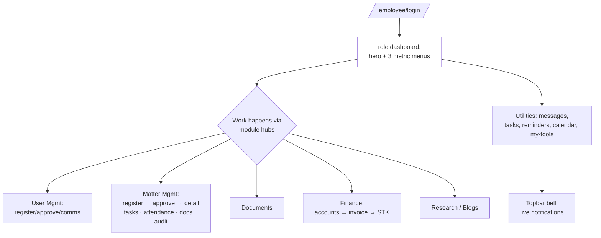
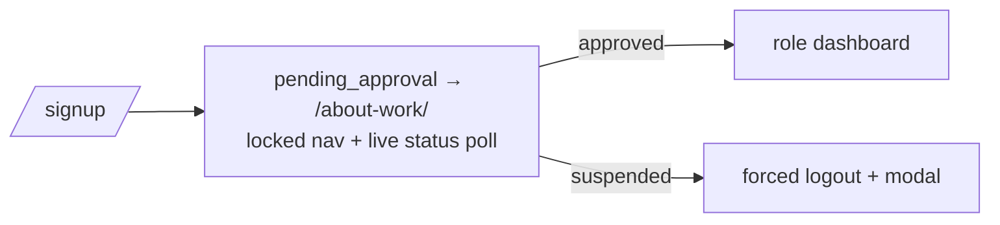

# Site Audit — Sheria-Centric (Phase 0)

Read-only audit of every page across the three surfaces, against the actual
code. Companion docs: `docs/ui-ux-audit.md` (design-system audit),
`docs/ui-conventions.md` (token/component contract — Phases 1–6 already done).

**This audit is about PAGES**: sitemap, journeys, per-page quality, missing
pages, SEO, performance, and responsive/a11y state — not the token system.

---

## 1. Architecture snapshot

### 1.1 The four layouts (there are really four, not three)

| Layout | Used by | CSS chain | Notes |
|---|---|---|---|
| `templates/base.html` | Auth pages, shared invoice, **product landing** | `auth.css` → `partnership-crest.css` (+ `site.css` on home only) | Has ``, ``, `mode_*` blocks, `.mode-toggle`, `extra_head`/`extra_js`. **No canonical/OG/robots blocks.** |
| `templates/accounts/firm/base.html` | All firm-site pages + `company_home.html` + `blog_list/detail` | base.html chain + `firm_site.css` via `` | Extends base.html; adds `firm_head` block, `_nav`/`_footer` includes, `#fw-main`, `firm_site.js`. **Forced `mode-light`** — no dark mode. No skip link target issue: `#fw-main` exists but no skip link rendered. |
| `templates/layouts/workspace.html` | ~140 staff pages | `tokens.css` → `app.css` → `motion.css` → `themes-dark.css` → `chrome.css` | Skip link ✓, sidebar + topbar + mobile-bar, live-poll suite. **No `noindex`, no canonical, no meta beyond a fixed description.** |
| `templates/layouts/client_portal.html` | 16 client pages | same chain | ~90% duplicate of workspace.html. `crumb_parts` is passed in context but **never rendered** (dead context; `.topbar__crumb` CSS is dead too). |

### 1.2 A critical routing fact: `/` is two different websites

`HomeView` (`accounts/views.py:737`) renders **either**:

- `accounts/company_home.html` — the firm website home (rich editorial page),
  when `WebsiteTemplateSetting.get_solo().uses_company_website` is truthy; **or**
- `accounts/home.html` — the Sheria Centric **product/platform landing**
  (violet `site.css`, hero slider, "Start free trial" → `client_signup`).

The firm site's nav "Home" (`accounts/firm/_nav.html:48`) points at
`accounts:home`, so when the toggle is off, "Home" leaves the firm site and
lands on the product landing — a different design language and a different
proposition. **Decision needed (see §10, D1).**

### 1.3 Routing

- Public + auth + client + item-level workspace actions: explicit `path()`s in
  `accounts/urls.py` (~116 routes).
- Every workspace *page* goes through `path("<slug:role>/<path:pages>/")` →
  `RoleWorkspaceView`, resolved by `resolve_workspace_page` + the nav registry
  in `accounts/workspace.py` (`SYSTEM_MODULES`, `PAGE_LOCAL_LINKS`,
  `SHARED_UTILITY_LINKS`, `EXTRA_PAGE_SLUGS`, `MODULE_EXTRA_ACTIVITIES`).
  New workspace pages register there — **not** in `urls.py`.
- `resolve_workspace_page` falls back to `workspace_page.html` ("not
  commissioned yet") for registered-but-templateless slugs.

---

## 2. Sitemap

### 2.1 Public / marketing surface

| Route | View → template | JS | Purpose | State |
|---|---|---|---|---|
| `/` | `HomeView` → `company_home.html` **or** `home.html` | `firm_site.js` / `site.js` | Firm home (CMS) or product landing | Dual-mode, see §1.2 |
| `/about/` | `FirmAboutView` → `firm/about.html` | firm_site | Story, values, team reel | Good |
| `/team/` | `FirmTeamView` → `firm/team.html` | firm_site | Team grid | **No member detail pages** |
| `/practice/` | `FirmPracticeListView` → `firm/practice_list.html` | firm_site | Practice index (scroll story) | Good |
| `/practice/<slug>/` | `FirmPracticeDetailView` → `firm/practice_detail.html` | firm_site | Area detail + related | Thin: no process/FAQ/team |
| `/gallery/` `/gallery/<slug>/` | `FirmGallery*View` → gallery templates | firm_site (lightbox) | Photo bento + detail | Good |
| `/faqs/` | `FirmFaqsView` → `firm/faqs.html` | firm_site (search/topics) | FAQ hub, search, topics, JSON-LD | Strong |
| `/contact/` | `FirmContactView` → `firm/contact.html` | firm_site | Contact info, map, CTAs | **GET-only — no enquiry form** |
| `/blog/` | `BlogListView` → `blog_list.html` | firm_site | Articles grid | **No search/categories/pagination** |
| `/blog/<slug>/` | `BlogDetailView` → `blog_detail.html` | firm_site + `blog-article.js` + `blog-track.js` | Article: reading time, share, related, analytics events | Strong |
| `/terms/` `/privacy/` | `FirmTerms/PrivacyView` | firm_site | Legal text from CMS | Good |
| `/blog-sitemap.xml` | `BlogSitemapView` | — | XML sitemap, **blog posts only** | Partial |
| `/robots.txt` | `RobotsTxtView` | — | robots + sitemap pointer | Incomplete disallows (§7.4) |

### 2.2 Auth surface (`base.html`, `auth.css`)

| Route | Template | Notes |
|---|---|---|
| `/employee/login/` + `/login/` | `login.html` | 6-digit code + password, show/hide, suspended modal, reset link |
| `/signup/` | `signup.html` | Employee registration → pending_approval |
| `/employee/password-reset/` (+done/confirm/complete) | `password_reset_*.html` | Full Django 4-step flow |
| `/work-email/set-password/<token>/` | `set_work_email_password.html` | Invite-style password set |
| `/employee/onboarding/` | `employee_onboarding.html` | workspace layout |
| `/employee/pending/` + `/about-work/` | `about_work.html` | Gated state, locked nav |
| `/client/login/` | `client_login.html` | Google GSI + email/password |
| `/client/signup/` | `client_signup.html` | Google or email |
| `/client/onboarding/` `/client/pending/` | client portal layout | Onboarding form, pending gate |

### 2.3 Client portal (`layouts/client_portal.html`)

| Route | Template | What it does today | Gaps |
|---|---|---|---|
| `/client/dashboard/` | `client_dashboard.html` | Greeting hero + metric tiles + module cards | **No active-matter progress, next steps, deadlines, recent docs, or outstanding-invoice strip** |
| `/client/matters/` | `client_matters.html` | Two tables (litigation / non-litigation), status pills | No progress/timeline summary; empty-copy only |
| `/client/matters/case/<id>/` | `client_matter_case.html` | Case detail + attendances | Read-only, no doc/messages tabs |
| `/client/matters/matter/<id>/` | `client_matter_detail.html` | Matter detail + attendances | Same |
| `/client/documents/` | `client_documents.html` | Table of docs, view/download links | **No search, no upload, no filter by matter, no status chips** |
| `/client/documents/<id>/view|file|download` + drive | `client_document_view.html` | In-portal preview | Minimal |
| `/client/messages/` | `client_messages.html` | Notifications inbox (read-only) | **Not a thread — no compose, no attachments, no reply** |
| `/client/reminders/` | `client_reminders.html` | Reminder list | — |
| `/client/calendar/` | `client_calendar.html` | Calendar of their events | — |
| `/client/finance-billing/` | `client_billing.html` | 5 metric tiles, invoices table, recent payments | No receipts page beyond invoice PDF; no ageing/status filter |
| `…/invoice/<id>/` `…/pay/` `…/pdf/` | `client_invoice.html`, `client_pay_invoice.html` | Invoice detail, M-Pesa STK pay, PDF | Solid |
| `/client/settings/` | `client_settings.html` | Profile, appearance link, security | — |
| `/client/theme-settings/` | `client_theme_settings.html` | Theme/font/density picker | — |
| `/invoice/shared/<token>/` (+pay, pdf) | `shared_invoice_pay.html` | Public shared-invoice pay page | Good |
| `/client/api/*` | JSON | notifications, status | — |

### 2.4 Workspace page tree (`/<role>/…`, registry in `workspace.py`)

Legend: template = `templates/accounts/<name>.html`; "hub" = `workspace_page.html` placeholder.

- **dashboard** → `dashboard.html` (hero + 3 metric dropdown tiles; live `matter-hub` revision)
- **User Management**
  - client-management → `client_management.html`; children: client-profile → `client_profile.html`, register-client → `register_client.html`, approve-pending-clients → `approve_pending_clients.html`, whatsapp-inbox → `whatsapp_inbox.html`
  - employee-management → `employee_management.html`; children: register-employee, onboarding-approvals, roles-permissions (→ `roles_permissions.html` + `roles_module_detail.html` + `roles_activity_permission.html`), employee-training, matter-allocation, employee-communications (messages/email/whatsapp/sms channels → `communication_channel|log|message.html`, email-settings), performance-compliance → `performance_compliance.html` + `employee_performance_analytics.html`, leave-availability, offboarding → `offboarding.html`
- **Matter Management** → `matter_management.html`
  - litigation-matters → `litigation_matters.html`; register-case → `register_case.html`, approve-registered-cases → `approve_registered_cases.html`
  - non-litigation-matters → `non_litigation_matters.html`; register-new-matter → `register_matter.html`, approve-registered-matters → `approve_registered_matters.html`
  - item level (explicit routes): `view_litigation_case.html`, `view_non_litigation_matter.html`, `entity_calendar.html`, `update_*_attendance.html`, `create_*_task.html`, `upload_documents.html`, `matter_entity_action.html`, `case_audit_progress.html`, `view_*_task.html`, `place_document_marks.html`, `document_marks`/`document_open_session`/`document_activity`
- **Document Management** → `document_management.html`; children: google-drive-settings; extras: upload-documents, document-activity; document-settings subtree (letterhead, digital-stamp, default-signature, templates-and-forms)
- **Finance & Billing**
  - general-accounts → `general_accounts.html`; accounting → `accounting.html` + 10 books → `accounting_book.html`; legacy slugs (payments→`payments.html`, purchasing/inventory/sales/customers/suppliers/banking/reporting — deep-link only)
  - client-accounts → `client_accounts.html` + `client_account_detail.html`; generate-invoice → `generate_invoice.html`; invoicing → `invoicing.html`; `view_invoice.html`, `pay_invoice.html`
  - employee-accounts: payroll → `payroll.html`/`register_payroll.html`/`employee_payroll_detail.html`/`payroll_receipt.html`, employee-advances, employee-petty-cashbook
  - company-accounts → `company_accounts.html`; register-account, topup-account, pay-expense, petty-cash-book → `petty_cash_book.html`
- **Research** → `research.html`; latest-news → `latest_news.html` (jobs/watches API family)
- **Blogs** → `blogs.html`; my-blogs → `my_blogs.html`, my-blogs-new → `my_blog_form.html`; company-blogs → `company_blogs.html` + `review_company_blog.html`; `blog_analytics.html`
- **Utilities** (every page): messages → `messages.html`, tasks → `tasks.html`, reminders → `reminders.html`, calendar → `calendar.html`, my-tools → `my_tools.html` (my-digital-stamp, my-digital-signature → `default_signature`/`my_digital_stamp.html`, templates-and-forms)
- **Settings** (personal): settings → `settings.html`, about-me, notification-settings, theme-settings
- **System settings**: website-template, company-theme, company-information (12 children: profile/contacts/about/homepage/images/practice-areas/team/testimonials/gallery/blogs/faqs/privacy/terms), document-settings (5 children), finance-settings, communication-settings

### 2.5 Orphans / dead ends / placeholders

- **`workspace_page.html`** renders "not commissioned yet" for any registered
  slug without a dedicated template (e.g. `employee-training`,
  `leave-availability`, `matter-allocation`, `legal-library` appear to fall
  here) — fine as a pattern, but these are linked in sidebars as real pages.
- `LEGACY_GENERAL_ACCOUNTS_SLUGS` (8 slugs) stay routable but are unlinked —
  pages render with stale design.
- `accounts/company_homepage.html` — workspace CMS editor for the home page
  (not a public page; name is confusing vs `company_home.html`).
- `home.html` (product landing) has its own nav/footer (`lp-*`), duplicating
  brand lockup; brand link intentionally goes to employee login.
- `templates/accounts/matter_entity_action.html`, `entity_calendar.html` shared
  by both matter types (good reuse).

---

## 3. User journeys

### 3.1 Visitor → enquiry/consultation (current)

```mermaid
flowchart TD
    A[Visitor lands] --> B{/ = firm site<br/>or product landing}
    B -->|firm site on| C[company_home: hero, practice slider,<br/>team reel, testimonials, insights, CTA]
    B -->|toggle off| D[home.html: product landing,<br/>Start free trial → client_signup]
    C --> E[Practice / About / Team / FAQs / Insights]
    E --> F[/contact/]
    F --> G{Enquiry options}
    G -->|tel:| H[Phone call]
    G -->|mailto:| I[Email client]
    G -->|wa.me| J[WhatsApp]
    G --> K[NO FORM — nothing captured,<br/>no tracking, no confirmation]
    D --> L[/client/signup/ or logins]
```

**Gap:** every conversion path ends in an external action; there is no
enquiry/booking form, no success state, no record.

### 3.2 Client lifecycle (current)

```mermaid
flowchart LR
    A[/client/signup/<br/>Google or email] --> B[/client/onboarding/<br/>type, contacts, ID upload]
    B --> C[/client/pending/]
    C -->|staff approves| D[/client/dashboard/]
    D --> E[matters · documents<br/>messages · billing<br/>calendar · reminders]
    E --> F[/pay → M-Pesa STK<br/>+ receipt/]
```

Client needs today vs target: dashboard shows *modules*, not *status*; no
"matter progress", no "next step", no upcoming deadline strip, no two-way
messaging, no document upload.

### 3.3 Staff daily workflow (current)



Missing for staff: **global search / command palette** — reaching a specific
client/case/invoice requires module → list → click; **breadcrumbs** — deep
pages (`/role/dashboard/matter-management/litigation-matters/case/12/edit-case-details/`)
only have a Back button; **notifications center page** — only a dropdown;
**keyboard shortcuts**; **saved views/filters** on list pages.

### 3.4 Employee onboarding (works, keep)



---

## 4. Per-page findings — public firm site

| Page | Works | Weak / missing |
|---|---|---|
| `company_home.html` | Editorial rail hero, practice book-slider, team reel, testimonials, insights, CTA band, OG+JSON-LD | Only reachable when toggle on; hero quick-links go to tel:/anchors, not a booking form; no trust-strip (credentials/LSK stats) |
| `home.html` (product landing) | Strong motion hero, typewriter, portal split | Sells the platform, not the firm; "Start free trial" → client_signup is a *client* signup, not a firm trial; no footer sitemap; brand → employee login |
| `firm/about.html` | Story/values/team reel | Long page, no credentials/accreditation block; inline `style=` (10) |
| `firm/team.html` | Photo cards, initials fallback | **No member detail pages**; no filter by practice area; no Person JSON-LD |
| `firm/practice_list.html` | Scroll-story presentation, progress rail | Editorial, but weak scanning for users who want a plain grid; no at-a-glance area index beyond dots |
| `firm/practice_detail.html` | Summary + related areas | **No services list, process steps, FAQs, related team, or form CTA** — the detail template is thin vs target |
| `firm/gallery_*` | Bento grid, topics, lightbox | Fine |
| `firm/faqs.html` | Search, topics, jump list, permalinks, FAQPage JSON-LD, CTA | Best-in-class page on the site |
| `firm/contact.html` | tel/mailto/WhatsApp hero, address/hours/directions, map iframe, portal band | **No enquiry form** (view is GET-only); no consultation scheduling; inline style on lede color |
| `blog_list.html` | Card grid, OG meta | **No categories, search, pagination, or featured post** — bare grid; no empty-state richness |
| `blog_detail.html` | Reading time, share (WA/X/LI/copy), related, analytics, Article JSON-LD, OG image | Breadcrumb present? partial; author block could link to a profile |
| `firm/terms|privacy.html` | CMS text, canonical | Bare `<h1>` + prose — no layout chrome consistency check needed; fine |
| `_nav` | Locale bar, brand, 8 links, portal CTAs, mobile drawer | No sticky condense-on-scroll shrink beyond existing; no practice-area mega-menu; "Employee" link prominent for a client audience |
| `_footer` | CTA strip, sitemap-ish columns, contacts, WhatsApp FAB | No legal links row (cookie/accessibility), no "back to top" |

**Missing pages entirely:** team member profiles, consultation/booking,
cookie notice, accessibility statement, careers (optional), and **error pages
404/500/403** (none exist — Django default debug/technical pages; only a CSRF
recovery view exists in `config/csrf.py`).

## 5. Per-page findings — client portal

| Page | Works | Weak / missing |
|---|---|---|
| Dashboard | Greeting, metrics, module cards | **Informational only** — no matter progress bars, next steps, upcoming appointments/deadlines, recent documents, outstanding balance strip |
| Matters list | Split tables, status pills | No progress %/stage; no "what happens next" hint |
| Matter/case detail | Details + attendances | No tabbed structure (overview/updates/documents/billing); no timeline |
| Documents | Table + in-portal view/download, Drive support | **No search/filter, no upload, no status chips** |
| Messages | Inbox table | **Notifications, not messaging** — no thread, reply, or attachments |
| Reminders / Calendar | Lists + calendar | OK |
| Billing | Metrics, invoices, payments, M-Pesa pay, PDF | No ageing buckets; receipts via PDF only |
| Settings / Theme | Profile, password, appearance | OK; notification prefs minimal |
| Onboarding / Pending | Gated flow, uploads | OK |
| Layout | Dark mode, mobile bar, skip link, staff-impersonation banner | `crumb_parts` dead context; **no `noindex`**; alerts hidden until active; session-clock pills are staff-flavored (active-time tracking is odd UX for a client) |

## 6. Per-page findings — workspace (staff)

| Area | Works | Weak / missing |
|---|---|---|
| Dashboard | Role hero, live metric dropdowns w/ pending items | Only 3 stats; **no deadlines/tasks/activity feed/quick actions** sections |
| Module hubs | Consistent `page-intro` + module-card grid + sidebar swap | Hub pages are nav-only — could surface real data (counts, recents) |
| List pages (matters/clients/etc.) | data-tables, status pills, approval flows | **No global filter bar / saved views / bulk actions pattern**; mobile card transform needs `data-label` on `<td>`s (annotated on few) |
| Detail pages (case/matter) | Sidebar action links, audit, docs, tasks | Deep pages lack breadcrumbs (`back_url` only); consistent page-header-with-actions pattern is informal |
| Notifications | Live bell dropdown + sound + browser push | **No notifications center page** — dropdown only; no activity log view |
| Search | `api/workspace/clients/search` exists for pickers | **No global search / ⌘K palette** |
| Keyboard | — | No shortcut system or help overlay |
| Settings/CMS | Company-info suite edits public site content | `company_homepage` editor ↔ public `company_home` naming collision is confusing |
| `workspace_page.html` | Honest placeholder + hub cards | Several *linked* sidebar destinations land here ("not commissioned") — either build them or mark disabled |

## 7. SEO baseline

### 7.1 What exists
- `` + `` on `base.html`; every
  firm page overrides both (`{{ page_title }} — {{ firm_name }}`).
- Canonical link on all 12 firm-page templates; OG/Twitter tags only on
  `company_home`, `blog_detail`, `blog_list` (partial).
- JSON-LD: Organization (home), Article (blog detail), FAQPage (faqs).
- `robots.txt` view; `blog-sitemap.xml` view (posts only).
- Auth/workspace/portal pages have unique-ish titles.

### 7.2 Gaps
- **No `sitemap.xml`** for static/practice/team pages (only blog posts).
- **No `noindex`** on workspace, portal, auth, or shared-invoice layouts.
- OG/Twitter missing on most firm pages (about/team/practice/gallery/faqs/contact/terms/privacy).
- No BreadcrumbList / Person / LegalService (only Organization) JSON-LD.
- `robots.txt` disallows `/employee/ /client/ /workspace/ /dashboard/ /it-support/ /admin/` — but role catch-alls also live at `/advocate/`, `/intern/`, `/managing-partner/`, `/firm-administrator/`, `/employee/` — **4 role prefixes not disallowed** (they redirect to login, so low SEO risk, but sloppy).
- Landing/auth pages: single shared meta description; home.html has no OG.
- Multiple `<h1>` risk is low (one per firm page); workspace h1 = topbar title (fine).

### 7.3 Friendly URLs
- Public: clean (`/practice/<slug>/`, `/blog/<slug>/`). Team members lack slugs → can't have profile URLs without model help (see D3).
- Workspace URLs are long but consistent; legacy `/dashboard/*` redirects exist.

### 7.4 Performance baseline
- Whitenoise + `GZipMiddleware` + `CompressedStaticFilesStorage` — compression
  ✓, but **no minification** anywhere.
- CSS weight: `app.css` ~636 KB / ~28k lines on *every* workspace+portal page;
  `firm_site.css` ~257 KB on firm pages; all render-blocking (normal for
  hand-CSS, but the 5-file workspace chain is heavy).
- Fonts: Google Fonts with `display=swap`, `preconnect` ✓; **no preload**;
  theme-settings pages fetch ~40 families.
- Images: `loading="lazy"` + width/height on most firm images; **no `srcset`/
  responsive variants**; `media/` ≈ 15 MB of uploads served as-is; hero image
  `eager` with fixed 1200×1600.
- JS: all `defer` ✓; ~50 small files, each workspace page loads ~7 global
  scripts + page scripts.
- Manual `?v=` busting on workspace/auth CSS+JS (drift risk); firm site uses
  mtime `` ✓.
- No resource hints/preload for critical assets; no `fetchpriority` on hero.
- Polling (`live-poll`) is adaptive and visibility-aware ✓.

## 8. Accessibility & responsive state (per surface)

Already-good (verified in docs + code): alt coverage, `th scope="col"`, native
`<dialog>` ×37, skip links on both workspace layouts, `prefers-reduced-motion`
gating, mobile rail/drawer/mobile-bar at ≤719px, sticky-first-column tables,
`data-label` mobile-card table transform (needs annotation rollout).

| Surface | Mobile (≤719) | Tablet (720–979) | Desktop | Dark mode | Known issues |
|---|---|---|---|---|---|
| Workspace | off-canvas + mobile-bar ✓ | icon rail ✓ | sidebar+topbar ✓ | per-theme + generated dark ✓ | no breadcrumbs; form errors lack aria-invalid/describedby; role="menu" on link lists; some <12px text |
| Portal | same ✓ (alerts gated) | same ✓ | same ✓ | ✓ | dead crumb context; session pills are staff-flavored |
| Auth/landing | `.content-shell` overflow trap; floating mode toggle | ✓ | split brand panel | forced per-surface, has dark remap | brand rail hidden on mobile (by design); no OG/noindex |
| Firm site | drawer nav, stacked sections; **light-only** | ✓ | full editorial | **none (forced light)** | no skip link; `role=tab` dots w/o `aria-controls` on carousels; no dark mode; `<h1>` only on firm pages ✓ |

## 9. Duplication & dead code inventory

- `client_portal.html` ≈ 90% of `workspace.html` — extract shared chrome
  partial (planned in earlier docs, not yet done).
- `crumb_parts` built in `client_portal.py:119` and `.topbar__crumb` CSS in
  `chrome.css` — both dead; **breadcrumbs were designed but never shipped**.
- `ROLE_NAV`/`ROLE_MODULES` in workspace.py partially vestigial.
- `?v=` strings to track when editing (current keys): `ql-qa-1` (tokens/app),
  `ql-icons-1` (motion), `ql-dark-1` (themes-dark), `ql-components-1` (chrome),
  `ql-shell-1` (app.js), `ql-mode-1` (theme-mode.js), `ql-auth-2` (auth.css +
  site.css), `?v=9`/`?v=7` (partnership-crest), `slide-counter-1` (site.js),
  `metric-menus-1`, `matter-scope-1`, `bg-poll-1`, `poll-throttle-2`. Firm
  site uses `` (auto).
- Two icon systems coexist (flat sprite `#i-*` canonical + `icon-orb` art);
  `ICON_*` Python strings inject sprite `<use>` — acceptable now.
- Public landing (`home.html`) and firm `_nav`/`_footer` implement separate
  chrome for the same brand.

## 10. Gap analysis vs target page set + decisions needed

### Target coverage scorecard

| Target | Status |
|---|---|
| Shared public layout (nav/footer/CTA) | ✅ exists (`firm/base` + `_nav`/`_footer`) |
| Home (hero, trust strip, practice grid, why-us, process, team, testimonials, insights, CTA) | ~80% — missing trust strip + process timeline |
| About | ✅ present, could add credentials block |
| Practice index + reusable detail | ⚠ detail thin (no services/process/FAQ/team/CTA) |
| Team grid + **member profiles** | ❌ no detail pages, no slugs on members |
| Insights listing + article | ⚠ list has no categories/search/pagination |
| Contact / **Book a Consultation** | ❌ no form at all — links only |
| FAQ | ✅ strong |
| Privacy / Terms | ✅ |
| Cookie notice / Accessibility statement | ❌ missing |
| 404/500/403 on-brand | ❌ missing |
| Auth pages | ✅ good (code+password unusual but intentional) |
| Portal dashboard (progress/next steps/deadlines/docs/invoices) | ⚠ module cards only |
| Matter detail tabs | ⚠ flat panels |
| Portal documents search/upload | ❌ view-only |
| Portal messages threads | ❌ notifications only |
| Workspace dashboard (stats+deadlines+tasks+activity+actions) | ⚠ hero+3 metric menus |
| ⌘K command palette / global search | ❌ |
| Breadcrumbs | ❌ (dead code exists) |
| Notifications center + activity log | ❌ dropdown only |
| Shortcuts overlay | ❌ |
| sitemap.xml / OG coverage / noindex | ⚠ partial |

### Decisions needed before Phase 1

- **D1 — The `/` duality.** Should Phase 2 treat the *firm site* (`company_home` +
  `firm/*`) as "the website" and keep the product landing as-is behind the
  toggle, or should the product landing move to e.g. `/platform/` so `/` is
  always the firm site? (Changing routing affects `accounts:home` everywhere.)
- **D2 — Consultation/enquiry capture.** No model exists. Options:
  (a) links-only (tel/WhatsApp/mailto) — zero backend work;
  (b) mailto-prefilled "compose" card + honeypot-free — zero backend;
  (c) new `FirmInquiry` model + staff inbox page — requires a model + view +
  migration (outside "presentation only"). Which is approved?
- **D3 — Team profiles.** `FirmTeamMember` has no slug; `Employee` rows join
  the public roster via `_firm_website_employees()`. A `/team/<slug>/` page
  needs a slug on FirmTeamMember (model change) or guest-member-only profiles.
  Approve model touch, or keep team list-only?
- **D4 — Firm-site dark mode.** Currently forced light; a `--fw-*` dark remap
  is a contained project. In scope for this engagement or deferred?
- **D5 — Portal two-way messaging & document upload.** Both need backend
  (message thread model, upload handling + permissions). In scope, or
  presentation-layer improvements only?
- **D6 — sitemap.xml.** Add `django.contrib.sitemaps` to INSTALLED_APPS +
  sitemap classes (tiny settings change), or keep the hand-rolled blog
  sitemap approach extended to static pages?
- **D7 — Workspace scope.** ⌘K palette needs a search endpoint(s). Build a
  lightweight unified search API (clients/cases/matters/documents/invoices)
  or restrict palette to page-navigation commands only (pure front-end)?
- **D8 — Linked-but-uncommissioned pages** (`employee-training`,
  `leave-availability`, `matter-allocation`, `legal-library`, …): build real
  pages, or mark disabled/"Soon" in nav until built?
- **D9 — Theme catalog.** Keep all 40 themes + 20 fonts (QA burden is real),
  or curate a reduced set? Does not block Phase 1.

## 11. Suggested phase-sequencing adjustments (for approval)

- Phase 1 additions on top of the brief: **`noindex`+SEO blocks on all three
  layouts**, **breadcrumbs** (resurrect `topbar__crumb`/`crumb_parts`),
  **error page set**, **shared chrome partial** for the two shells.
- Phase 2: extend `firm_site.css` minimally with a `.fw-*` trust strip,
  process timeline, practice-detail content blocks, team-profile template,
  enquiry section on contact (per D2), insights list search/categories,
  cookie/accessibility pages, sitemap.
- Phase 3: portal dashboard content (matter progress, deadlines, recent docs,
  balance), matter tabs, document search, billing ageing — mostly template +
  context work; messaging/upload depend on D5.
- Phase 4: workspace page-header pattern (title+crumb+actions), ⌘K (per D7),
  notifications page, tasks/deadlines strip on dashboard.
- Verification per phase: `py manage.py check`, `py manage.py test accounts`,
  `py scripts/check_contrast.py`, plus 360/720/980/1280 visual pass in light
  + dark.
