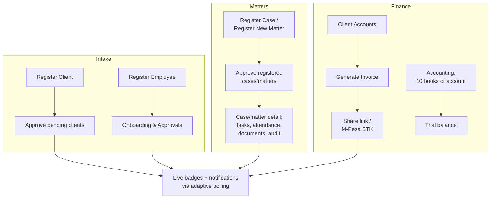

# UI/UX Audit — Sheria-Centric

Read-only reverse-engineering of the implemented front end. All findings are based
on the code as it exists; line references point at the current files.

---

## 1. Tech stack summary

| Layer | What is actually used |
|---|---|
| Framework | **Django 5.0 server-rendered templates** (DTL). No React/Vue/HTMX/Alpine. |
| Routing | `accounts/urls.py` (~116 routes). Public site + auth use explicit paths; the entire staff workspace is served through one catch-all `path("<slug:role>/<path:pages>/")` resolved by the navigation registry in `accounts/workspace.py`. |
| Styling | **Hand-written vanilla CSS, BEM-ish naming** (`.panel__head`, `.btn--primary`, `.is-active`). No Tailwind, no CSS modules, no SCSS, no component library (no MUI/Bootstrap). Design tokens are CSS custom properties. |
| CSS files | `static/css/app.css` (**28,186 lines** — the whole workspace), `chrome.css` (2,077 — sidebar/topbar overrides), `auth.css` (1,767 — auth + onboarding), `site.css` (1,589 — landing page), `firm_site.css` (11,929 — public firm website), `motion.css` (1,441 — "3D clay" icons + motion), `partnership-crest.css` (529). |
| JavaScript | ~50 small **vanilla JS** files in `static/js/`, loaded per page via ``. `app.js` = shell behavior (sidebar, dropdowns, clock, reveal animations); `live-poll.js` = adaptive fetch polling (4s → 30s backoff); `toasts.js` = toast lifecycle. No bundler, no modules — plain scripts with `defer`. |
| Layouts | `templates/base.html` (auth + public shell), `templates/layouts/workspace.html` (employee shell: sidebar + topbar), `templates/layouts/client_portal.html` (client shell — **~90% duplicated markup** of workspace.html), `templates/accounts/firm/base.html` (public firm site). |
| Icons | Inline stroke SVGs everywhere. Two icon systems: **icon-3d "clay" icons** (`motion.css` + `templates/accounts/partials/icon_3d*.html`) and **flat icons** (`icon_flat*.html`). Many icon SVG strings are defined as `ICON_*` constants inside `accounts/workspace.py` and injected with `{{ icon|safe }}`. |
| Fonts | Google Fonts. Workspace default: **IBM Plex Sans** (+ Playfair Display serif accents). **20 user-selectable font pairings** (`accounts/appearance.py` `FONT_CATALOG`). Auth/landing: Plex Sans + Playfair Display. Firm site: **Cormorant Garamond + Outfit**. |
| State | Server-side Django state + session; client "live" state via polling endpoints (`live-poll.js`, `live-notifications.js`, `live-list.js`, `live-entity.js`, `live-session.js`). Active-time tracking persisted to `localStorage` (`app.js`). |
| Build/perf | No build step. Cache-busting via manual `?v=...` query strings and a `static_bust` template tag. |

**The product is really three design languages sharing one codebase:**
1. **Workspace** (employee + client portal) — neutral canvas, dark themed sidebar/topbar, per-user accent theme.
2. **Auth/landing** — fixed purple/violet palette (`auth.css`, `site.css`), glassy cards, Playfair serif.
3. **Public firm site** — navy + brass "chambers" editorial look (`firm_site.css`), Cormorant + Outfit.

---

## 2. Design system documentation

### 2.1 Where tokens live

Tokens are **centralized per surface** — each stylesheet owns a `:root`/`body` token block.
There is no single global token file; instead there are **four parallel token systems**:

| Surface | File | Token prefix | Anchor |
|---|---|---|---|
| Workspace | `static/css/app.css:1-38` (base) and `:52-128` (`body.workspace`) | `--ink`, `--accent`, `--surface`, `--sidebar-*`, `--density-*` | `body.workspace` + 40 theme classes |
| Auth | `static/css/auth.css:1-39` | `--purple-*`, `--brass`, `--ink` | `:root` (fixed, no theming) |
| Landing | `static/css/site.css:3-21` | `--lp-*` | `:root` |
| Firm site | `static/css/firm_site.css:3-23` | `--fw-*` | `:root` |

### 2.2 Color

**Workspace semantic tokens** (`app.css:52-128`, values vary per theme):

| Token | Role | Example (theme-product) |
|---|---|---|
| `--ink` / `--ink-muted` | Primary / secondary text | `#1f1f1f` / `#6e6e6e` |
| `--line` | Borders | `#e8e8e8` |
| `--accent` / `--accent-strong` / `--accent-soft` | CTA, focus, selected wash | `#2c2c2c` / `#141414` / `#f2f2f2` |
| `--surface` / `--surface-tint` | Cards / alt rows | `#ffffff` / `#f7f7f7` |
| `--page-bg` | Canvas | `#f2f2f2` |
| `--sidebar-bg/-ink/-muted/-line/-hover/-active/-active-ink` | Chrome | `#1f1f1f` … |
| `--danger`/`--danger-bg`/`--danger-line` | Errors | `#b42318` / `#fef3f2` |
| `--success`/`--success-bg`/`--success-line` | Success | `#067647` / `#ecfdf3` |
| `--warning` | Warnings | `#b45309` |
| `--notif-badge`/`--notif-badge-ink` | Unread badges | per-theme (`app.css:987-1026`) |
| `--icon-1..7` | Icon tone palette | hard-coded set (`app.css:102-108`) |
| `--brand-gold` | Brand accent | `#fca311` |
| `--link`, `--kicker`, `--title`, `--heading`, `--focus-ring` | Aliases | map to accent/ink |

**Theming** (`app.css:162-986` + `accounts/appearance.py`):
- 40 `.theme-*` classes: 8 role themes (`theme-product`, `theme-firm_admin`, `theme-managing_partner`, `theme-advocate`, `theme-intern`, `theme-it_support`, `theme-employee`, `theme-client`) + 32 "studio/accent/modern" themes (`midnight`, `graphite`, `cedar`, `cobalt`, `olive`, `copper`, `arctic`, `espresso`, `jade`, `marine`, `sunrise`, `citrus`, `azure`, `emerald`, `saffron`, `flamingo`, `electric`, `ruby`, `lime`, `orchid`, `violet_glow`, `teal_matter`, `orange_brief`, `rose_seal`, `blue_docket`, `verdant_leaf`, `amethyst_file`, `indigo_list`, `ember_court`, `fuchsia_client`, `cyan_harbor`, `blush_advice`).
- Only **`theme-midnight` is a true dark theme** (dark surfaces + light ink); all others are light canvases with dark sidebars.
- Resolution: personal choice → session snapshot → `CompanyThemeSetting` (`appearance.py:291-324`). Clients get the same mechanism (`appearance.py:464-527`).
- Dark/light mode is **theme-picked, not OS-driven** — no `prefers-color-scheme` handling anywhere.

**Hard-coded colors**: ~1,932 hex values in `app.css` (many inside theme blocks, but component CSS also hard-codes: `.status-pill--*` variants `#166534`/`#dcfce7`/`#9a3412`/`#ffedd5`/`#991b1b`/`#fee2e2`/`#92400e`/`#fef3c7` at `app.css:4576-4630+`, `#fff` input/modal backgrounds at `2809`, `2928`, `2946`, `3010`, `6901`, Google button colors `11636-11638`).

**Auth palette** (`auth.css:1-39`): violet scale `--purple-50…950` (`#f5f4ff`…`#07071a`), `--brass: #e8c547`, teal/orange accents — **not themeable**, fixed brand purple.

**Firm site palette** (`firm_site.css:3-23`): ink `#060e1a`, accent teal `#2a5f68`, brass `#b8975a`, paper `#eef1f4` — also fixed.

### 2.3 Typography

| Token | Value | Where |
|---|---|---|
| `--font-sans` | "IBM Plex Sans", "Segoe UI", sans-serif | `app.css:2` |
| `--font-serif` | "Playfair Display", "Libre Baskerville", Georgia, serif | `app.css:3` |
| `--text-xs/sm/base/md/lg/xl` | 0.72 / 0.8125 / 0.9375 / 1.0625 / 1.25 / clamp(1.35→1.7) rem | `app.css:68-73` |
| `--leading-tight/body/loose` | 1.25 / 1.55 / 1.7 | `app.css:74-76` |
| `--tracking-tight/ui/wide` | -0.025em / -0.011em / 0.07em | `app.css:77-79` |
| Density overrides | `.density-compact` shrinks type to 0.875/0.75/0.68 | `app.css:1029-1059` |

- Heading hierarchy: topbar `<h1 class="topbar__title">` (workspace.html:193) is the page h1; content sections use `<h2>` in `.page-intro` (`app.css:2498-2507`) and `<h3>` in `.panel__head` (`2608-2615`). Consistent pattern.
- Serif is used sparingly in workspace (modal heads `6868`, brand name auth `auth.css:403`); body is sans.
- **20 switchable font pairings** loaded from Google Fonts (`appearance.py:136-197`). Only the active pair is requested per page (`google_fonts_stylesheet_href`, `appearance.py:200-226`) — except the theme settings page which requests **all ~40 families** (`include_all=True`).
- Firm site uses its own pair (Cormorant Garamond 400/500/600 + Outfit 300-700) loaded in `firm/base.html:9`.

### 2.4 Spacing & layout

- **No numeric spacing scale** (no `--space-1…8`). Spacing is ad-hoc rem values plus **density tokens**: `--density-pad`, `--density-gap`, `--density-row-y/x`, `--density-nav-y/x`, `--density-content` (`app.css:82-89`), overridden by `.density-compact`/`.density-airy` (`1029-1064`). This is actually a decent density system — but it only covers ~8 variables; hundreds of literal `rem`/`px` values exist elsewhere.
- Shell layout: `.workspace-shell` CSS grid; **sidebar off-canvas below 980px** (`translateX(-104%)`, backdrop, `app.css:1086-1127`), **sticky column ≥980px** (`6756-6769`). Topbar inside `.workspace-main`.
- Content width: `.page` max-width `min(72rem, 100%)` on desktop, with per-page-type caps: `--centered` 40rem, `--form-narrow` 32rem, `--form-medium` 42rem, `--form-wide`/`--register-case` 56rem, `--register-employee` 52rem, `--docs` 60rem, `--client-accounts` 64rem (`app.css:2393-2424`, `6786-6831`). Also several **per-page one-off caps** (`page--company-accounts`, `page--case-detail`, `settings-page--compact`) — width taxonomy is fragmenting.
- Landing max width `--lp-max: 72rem`; firm site `--fw-max: 74rem`.

**Breakpoints — there is no breakpoint scale.** `app.css` alone uses ~20 distinct values:

| Value | Count | | Value | Count |
|---|---|---|---|---|
| 720px | 17 max + 8 min | | 640px | 14 max + 8 min |
| 560px | 6 max + 1 min | | 480px | 5 max + 1 min + 1 (479 max) |
| 900px | 6 max + 4 min | | 980px | 3 max + 4 min + 1 (981 min) |
| 960px | 3 max | | 760px | 3 max |
| 860px | 2 max + 1 min | | 1100px | 2 min |
| 380/420/519/520/559/639/719/840/920px | 1 each | | | |

JS mirrors a few (`matchMedia("(min-width: 980px)")` in `app.js:14`).

### 2.5 Other tokens

| Token | Values | Location |
|---|---|---|
| Radius | `--radius:10px`, `--radius-sm:8px`, `--radius-lg:14px`; pills `999px`; bespoke values `1.35rem`, `16px`, `12px`, `4px` (theme-admin) scattered | `app.css:6-8` |
| Shadows | `--shadow-xs/sm/md/lg` via `color-mix` on `--ink` | `app.css:19-25` |
| Easings | `--ease: cubic-bezier(0.22,1,0.36,1)`, `--ease-out: cubic-bezier(0.16,1,0.3,1)` | `app.css:4-5` |
| Transitions | Hand-rolled per component, mostly `0.15–0.3s var(--ease)`; no duration tokens | throughout |
| z-index | **Not tokenized.** Observed: 2 (nav-badge), 30 (backdrop), 40 (sidebar/dropdowns/notif menus), 80 (toast-stack) | `app.css`, `auth.css:983` |
| Motion | 8 `prefers-reduced-motion` blocks in app.css + JS gates (`app.js:310`, `reduceMotion`) | — |

### 2.6 Verdict on the design system

Genuinely **token-driven at the theme level** (excellent `color-mix`-based derived colors), but **not tokenized below the surface level**: no spacing scale, no z-index scale, no breakpoint scale, no duration tokens, and ~2,000 hard-coded hexes across component CSS — many of which **do not adapt to dark themes** (hard `#fff` backgrounds in `.form-input:focus` `app.css:2809`, `.choice-chip` `2928`, `.country-menu` `3010`, `.workspace-modal__body .form-input` `6901`).

---

## 3. Component inventory

Naming is BEM-ish and reasonably consistent. "Usage" = distinct templates/files referencing the class family (approximate, grepped).

| Component | Path | Variants / states | Usage | Issues |
|---|---|---|---|---|
| Button `.btn` | `app.css:4498-4568`, overrides `chrome.css:711-734`, `auth.css:915-968` | `--primary`, `--danger`, `--quiet`, `--inline`, `--ghost`(auth), `--warn`, `--success`, `--google`, `--docs-*`, `--with-icon`; `.is-loading` + `.btn-spinner` (`5035-5049`); hover = lift + glow | ~all forms/pages | **Three different primary-button looks**: pill 999px (app.css), 10px radius (chrome.css:714 overrides it), gradient 10px inside `.workspace-form .btn--inline` (`3051-3080`), and a 4th full-width pill in auth.css. Disabled state barely styled (only `:disabled` on `--docs-*`). |
| Input `.form-input` | `app.css:2776-2811` (workspace), `auth.css:635-821` (auth), `6895-6910` (modal) | text/textarea/select, `--file`, `--title`, `.input-uppercase/-lowercase`; hover/focus/error via sibling `.field-error` | ~85 forms | Focus rings differ between auth (`rgba(121,112,255,.2)`) and workspace (accent 18%). Dark themes get hard `#fff` focus bg. No `aria-invalid` wiring (see §5). |
| Field wrapper `.form-field` / `.field-hint` / `.field-error` / `.form-alert` | `app.css:2758-2882`, `auth.css:511-913` | hint, error, non-field alert | ~all forms | Errors rendered as sibling `<span class="field-error">` — **not linked to inputs** (`aria-describedby` absent). |
| Select/choice `.choice-chip` | `app.css:2918-2956` | pill radio/checkbox chips, `:has(input:checked)` styling | onboarding, settings | Relies on `:has()` (no fallback needed in 2025+ browsers, OK). |
| Country/phone `.country-trigger`/`.country-menu` | `app.css:2967-3049`, `auth.css:674-802`; JS `country-phone.js` | custom listbox w/ search + flags | onboarding, signup, register forms | Custom dropdown — keyboard semantics unverified (aria-haspopup="listbox" is set; arrow-key nav lives in JS). External flag images from `flagcdn.com`. |
| Panel/card `.panel` | `app.css:2583-2724`, `chrome.css:652-679` | `__head`, `__body`, `__body--table`, `--note`, accent-dot heading pseudo-element | ~80 pages | Consistent. `panel__head h3::before` dot = decorative but always accent — fine. |
| Data table `.data-table` | `app.css:3148-3188`, `chrome.css:681-699` | striped hover, sticky-ish header styling, `.is-clickable-row`, `.data-table-wrap` horizontal scroll | 68 `<table>`s | `th`/`td` `white-space: nowrap` → horizontal scroll on mobile (has wrap, OK). Headers use `scope="col"` (367 uses — good). chrome.css recolors `th` to sidebar-dark — a second table look. |
| Status pill `.status-pill--*` | `app.css:3135-3146`, variants `4576+` | ~15 statuses (active, pending, suspended, approved, present/absent, partial…) | lists/detail pages | Colors hard-coded per variant, **not tokenized or theme-aware** (e.g. fixed `#dcfce7`). |
| Metrics `.metric`/`.metrics--dash`/`.metric--glass`/`.metric-menu`/`.metric-dropdown` | `app.css:2544+`, `chrome.css:263-649` | glass cards, interactive menu variant, count-up animation (`app.js:365-426`) | dashboard | `metric-dropdown` uses `role="menu"`/`menuitem` on what is a nav link list — ARIA misuse. `!important` overrides at `chrome.css:646-648`. |
| Modal `.workspace-modal` | `app.css:6834-6922` + per-modal subclasses; JS `showModal()` in 11 files | `<dialog>`-based, `::backdrop`, `__card/__head/__body/__actions` | 37 `<dialog>`s | Good native-dialog usage. Some modals restyle actions/footer per-instance (`court-attendance-modal` `11512-11628`). No shared confirm-dialog component — each modal is bespoke. |
| Toasts `.toast`/`.toast-stack` | `auth.css:977-1016+`, rendered by `templates/partials/messages_toast.html`, JS `toasts.js` | success/error/warning/info/debug, progress bar, pause on hover/focus, `role=alert`/`status` | every page (layout-level) | Solid. Durations: error 7.5s, success 2.2s (`toasts.js:2-8`). Positioned top-center fixed. |
| Sidebar `.sidebar`/`.nav-link`/`.nav-badge`/`.nav-section` | `app.css:1086-1360`, `chrome.css:7-58` | `is-active` (accent inset bar), `is-disabled` + `.nav-soon` "Locked" pill, `has-unread` badge | workspace + client shells | Disabled items use `href="#"` + `aria-disabled` + `tabindex="-1"` — OK. Badges have accessible `aria-label` with counts. |
| Topbar `.topbar`/`.topbar-pill`/`.icon-btn`/`.profile-menu`/`.notif-menu`/`.session-menu` | `chrome.css:61-260`, `workspace.html:182-361` | pills (date/time/firm), dropdowns (notifications, session, profile) | both shells | Dropdowns: click + Escape + outside-click close; **no arrow-key navigation** despite `aria-haspopup`/`role="menu"` — incomplete menu pattern. |
| Icon systems `.icon-orb`, `.icon-3d`, `.icon-flat`, `.icon-tile` | `motion.css` (3D), `app.css`, partials `icon_3d*.html`, `icon_flat*.html` | tones `--1..7` + ~20 named hues, sizes sm/lg | dashboards, module cards, docs | Two parallel icon rendering systems (3D clay vs flat) — visual inconsistency by design? Named colors hard-coded in `motion.css:31-58`. |
| Empty state `.empty-state` | `app.css:6447+`, `4005` | `__rule`, `__title`, `__copy` | ~15 list pages | Present but not universal — several tables just render no rows. |
| Access-denied modal | `templates/partials/access_denied_modal.html`, `access-denied-modal.js` | `<dialog>`, emoji "hand" icon | permission-blocked actions | Uses emoji 🙅 as visual — clashes with otherwise restrained iconography. |
| Suspended modal `.suspended-modal` | `login.html:102-157`, auth.js | `<dialog>` | login | Good — `aria-labelledby`/`describedby` set. |
| Auth card `.auth-card`/`.auth-shell`/`.auth-brand` | `auth.css:95-503` | split layout: brand rail (desktop) + form card | login/signup/reset ×~10 pages | `body.auth-page` = `height:100dvh; overflow:hidden` with a `:has(.content-shell)` escape hatch — fragile pattern. |
| Roles matrix `.roles-switch`/`.roles-perm-matrix` | `app.css` (~roles-* families) | toggle switches, permission grid | roles_* pages | Custom switches — verify keyboard/focus; uses `roles-switch` pattern. |
| Page furniture `.page-intro`/`.page-kicker`/`.page-lead`/`.register-section`/`.register-grid` | `app.css:2372-2535`, `6924-7000+` | kicker + h2 + lede; icon-headed form sections | most pages | Consistent and reusable — the strongest "pattern" the codebase has. |
| Feature-specific | `app.css` bulk | `gen-inv-*`, `drive-browser`, `mailbox`, `doc-stamp/signature/letterhead`, `signature-pad`, `wa-inbox`, `news-*`, `matter-*`, `calendar-*`, `task-calendar`, `live-task-*`, `dap-timeline`, `invoice-sheet`, `party-*`, `theme-card`, `font-card`, `letterhead-mini`… | 1-2 pages each | ~60% of app.css is single-page CSS. Fine for velocity, but it's why the file is 28k lines. |

---

## 4. Page & user flow map

### 4.1 Route map (from `accounts/urls.py` + `accounts/workspace.py`)

| Area | Routes / pages | Layout |
|---|---|---|
| **Public firm site** | `/` (landing, `home.html` — actually the *platform* landing, dark violet), `/about/`, `/team/`, `/practice/` + detail, `/gallery/` + detail, `/faqs/`, `/contact/`, `/blog/` + detail, `/terms/`, `/privacy/` | `accounts/firm/base.html` + `firm_site.css` |
| **Employee auth** | `/employee/login/` (+ `/login/` alias), `/signup/`, `/employee/password-reset/` (4-step Django flow), `/work-email/set-password/<token>/` | `base.html` + `auth.css` |
| **Client auth** | `/client/login/` (Google or email), `/client/signup/`, `/client/google/` | `base.html` + `auth.css` |
| **Employee workspace** | `/workspace/`, `/dashboard/`, `/<role>/…` catch-all → `workspace.py` page registry | `layouts/workspace.html` |
| Workspace modules | User Management → Client Mgmt (portal, register, approve, WhatsApp inbox) + Employee Mgmt (register, onboarding, roles & permissions, training, allocation, communications, performance, leave, offboarding); Matter Mgmt → Litigation (register/approve cases) + Non-litigation; Document Mgmt; Finance & Billing → General/Client/Employee/Company accounts → Accounting (10 books), Payroll, Advances, Petty cash, Invoicing; Research (Latest News, Legal Library); Blogs | — |
| Workspace utilities | Messages, Tasks, Reminders, Calendar, My tools (digital stamp, signature, templates) | — |
| Settings | Personal: settings (profile), about-me, notification-settings, theme-settings. System: website-template, company-theme, company-information (12 sub-pages), document-settings (letterhead, stamp, signature, templates, Drive), finance-settings, communication-settings | — |
| **Client portal** | `/client/dashboard/`, `/client/matters/` + case/matter detail, `/client/documents/` + view/download, `/client/messages/`, `/client/calendar/`, `/client/reminders/`, `/client/finance-billing/` + invoice/pay, `/client/settings/`, `/client/theme-settings/`, `/client/onboarding/`, `/client/pending/` | `layouts/client_portal.html` |
| **Shared/public invoice** | `/invoice/shared/<token>/` (view + STK pay + pdf) | `base.html` |
| **API/JSON** | ~30 endpoints: workspace notifications/badges/list-revision/entity-status, client search, field suggestions, WhatsApp inbox poll, STK status, latest-news jobs/watches, blog tracking, integrations (Google Drive, M-Pesa callbacks, WhatsApp webhook) | — |

### 4.2 Employee lifecycle

```mermaid
flowchart LR
    A[/signup/] -->|creates Employee<br/>status=pending_approval| B{Admin approves?<br/>Django admin or<br/>Onboarding & Approvals}
    B -->|no| C[/employee/login/ →<br/>about-work/ page<br/>nav shows "Locked" badges]
    B -->|yes, status=active| D[/dashboard/<role><br/>role-themed workspace]
    D -->|status→suspended| E[live-poll detects →<br/>sign out + suspended modal]
    C -->|status→suspended| E
```

- Login uses a **6-digit login code + password** (`login.html`) — unusual but intentional; signup offers Google for clients, code+password for staff.
- Pending users land on `about_work` with sidebar links disabled (`aria-disabled`, "Locked" pill) — a decent gated state.

### 4.3 Client lifecycle

```mermaid
flowchart LR
    A[/client/signup/] --> B[/client/onboarding/<br/>client type, contacts,<br/>ID documents upload]
    B -->|submit| C[/client/pending/<br/>awaiting firm activation]
    C -->|staff approves<br/>approve-pending-clients| D[/client/dashboard/<br/>matters, documents,<br/>messages, invoices]
    D --> E[/invoice pay →<br/>M-Pesa STK push<br/>stk-status poll/]
    F[/client/login/ Google<br/>or email+password] --> B
```

### 4.4 Core staff flows



### 4.5 Navigation pattern

- Sidebar = three zones: **brand + Dashboard** (`sidebar__primary`), **"In this section"** contextual links (`page_nav_items` from `PAGE_LOCAL_LINKS` in `workspace.py:718-749`), **"Account"** utilities + settings + logout + user card.
- Sidebar depth is page-contextual (not a global tree) — you navigate module → sub-page and the sidebar swaps to that section's links. Consistent, but **no breadcrumbs** (`.topbar__crumb` CSS exists in `chrome.css:81-91` but **no template uses it — dead code**) so deep pages rely on a `back_url` button.
- Topbar: hamburger (<980px), page title h1, notifications bell w/ badge, live date/time pill, session-time dropdown, firm pill, profile dropdown.

### 4.6 State handling

| State | Implementation |
|---|---|
| Loading | Almost none. `notif-list` shows "Loading…" text; `.btn.is-loading` + `.btn-spinner` exist (`app.css:5035`) but are only wired on ~5 pages (stk-pay, communication settings, company contacts, client account detail). **No skeletons, no spinners on page loads or polling refreshes.** |
| Empty | `.empty-state` partial pattern on ~15 pages (title + copy + rule). Inconsistent — not every list has one. |
| Error | Django `messages` → toast (`role="alert"`, 7.5s). Form errors → `.form-alert` (non-field) + `.field-error` per field. MySQL/connectivity → `SystemExit` text pages (dev). |
| Success | Toast (2.2s auto-dismiss) + optional redirect. |
| Access denied | `access_denied_modal` `<dialog>` with 🙅 emoji; locked nav items show `aria-disabled` + "Locked"/"Soon" pills. |
| Suspended | Live-status poll → forced logout → suspended `<dialog>`. |
| Offline/transient | Polling silently retries (`live-poll.js:62`); no offline indicator. |

### 4.7 Form validation & feedback

- **85 templates use `novalidate`** — browser validation suppressed; validation is **server-side** (Django `forms.py`, 277 `required=` definitions) with errors re-rendered inline. Some pages add JS helpers (`register-case.js`, `client-onboarding.js`, `communication-settings-verify.js` for test-connection flows).
- Required marker is `<span aria-hidden="true">*</span>` — visual-only asterisk.
- Error copy style is consistent (`field-error`, `form-alert`), but **errors are not programmatically associated** with inputs and **focus is not moved to the first error** on failed submit.

---

## 5. Audit findings (ranked)

### High

| # | Finding | Evidence |
|---|---|---|
| H1 | **28k-line monolithic stylesheet with heavy internal overrides.** `app.css` (28,186 lines) is restyled by `chrome.css` (loaded after) — e.g. `.btn--primary` re-radiused 999px→10px (`app.css:4524` vs `chrome.css:714`), `.data-table th` re-themed (`chrome.css:681`), `.metric` rebuilt (`chrome.css:272`), `!important` used to win (`chrome.css:646-648`). **108 `!important`s in app.css, 9 in chrome.css, 44 in firm_site.css.** Cascade order is load-order-dependent and fragile. | `app.css`, `chrome.css` |
| H2 | **No error↔input association; zero `aria-invalid`.** `.field-error` is a sibling span with no `id`/`aria-describedby` link; inputs never get `aria-invalid="true"`. Required fields show an `aria-hidden` asterisk (`register_case.html:104` etc.). Screen readers get no error or required context per field. | all form templates; `aria-describedby` appears only 4× in the whole codebase |
| H3 | **No skip-navigation link.** 157 templates, no `skip-` anything. Sidebar = dozens of tab stops before content on every page. | all layouts |
| H4 | **Three parallel token systems that never converge.** Workspace `--ink/--accent`, auth `--purple-*`, firm `--fw-*`, landing `--lp-*` — same concepts, four vocabularies, all hand-maintained. Any brand change = 4-file edit with no shared source of truth. | `app.css`, `auth.css`, `firm_site.css`, `site.css` |
| H5 | **~20 breakpoint values, no scale.** 479/480, 519/520/559/560/639/640, 719/720, 760, 840/860/900/920/960/980/981/1100… Media queries are per-component improvisations; mobile behavior can't be reasoned about globally. | `app.css` media queries |
| H6 | **Dark-theme hazards in component CSS.** Hard `#fff`/`#ffffff` backgrounds and `#3c4043`-style text in form inputs, choice chips, country menus, modal bodies (`app.css:2809, 2928, 2946, 3010, 6901, 11636-11638`) while `theme-midnight` (and dark-ish studio themes) set dark surfaces. Components will render white boxes inside dark UI. `.status-pill--*` colors are fixed light-theme pastels (`4576-4630`). | app.css |
| H7 | **Duplicated shell markup.** `layouts/client_portal.html` is ~90% of `layouts/workspace.html` copy-pasted (sidebar, topbar pills, session menu, profile menu, footer). Already drifting: client shell lacks `back_url`/`dashboard_disabled` logic, adds a theme-settings link and staff banner; employee shell got `sidebar-back`/`nav-icon-wrap` updates the client shell partially misses. Any chrome fix must be applied twice. | `layouts/workspace.html` vs `layouts/client_portal.html` |

### Medium

| # | Finding | Evidence |
|---|---|---|
| M1 | **Menu ARIA pattern incomplete.** `aria-haspopup`/`aria-expanded`/`aria-controls` are wired, but profile dropdown claims `role="menu"` + `menuitem` (`workspace.html:335-356`) with **no arrow-key/Home/End navigation** — a `menu` contract the code doesn't honor. `metric-dropdown` also uses `role="menu"` on a list of links (`dashboard.html:71`). Either implement menu key behavior or drop `role="menu"` (a plain `div`/list is more honest for link collections). | `app.js:27-118`, `workspace.html`, `dashboard.html` |
| M2 | **No loading states for async UI.** Polling refreshes lists silently; dropdowns show bare "Loading…" text; submit buttons have `.is-loading` support wired on only ~5 of ~85 forms. Users get no feedback during STK push, Drive sync, form posts (browser navigation covers those, but async actions don't). | `toasts.js`, `live-poll.js`, `app.css:5035` |
| M3 | **Untokenized z-index** (2/30/40/80 ad-hoc) invites stacking bugs as more floating UI is added (modals over dropdowns over toasts?). | `app.css`, `auth.css:983` |
| M4 | **~104 inline `style=` attrs across 45 templates** — mostly `--stagger` CSS-var passing (acceptable technique) but also presentational styling in `firm/about.html` (10), `firm/contact.html` (9), `theme_settings.html`, `whatsapp_inbox.html`, `client_billing.html`. | templates |
| M5 | **`body.auth-page` overflow trap.** `height:100dvh; overflow:hidden` with a `:has(.content-shell)` escape hatch (`auth.css:65-76`) — any new auth page that forgets the wrapper class gets an unscrollable clipped layout. | `auth.css` |
| M6 | **Dead/vestigial CSS**: `.topbar__crumb` styled but never used; `.metric__chevron`, `.session-caret`, `.session-trigger__date` partially unrendered; `LEGACY_GENERAL_ACCOUNTS_SLUGS` keeps 8 dead slugs routable. Likely more — a coverage pass would probably cull 10-20% of app.css. | `chrome.css:81-91`, `workspace.py:600-610` |
| M7 | **External runtime dependencies for cosmetics**: Google Fonts CSS is render-blocking on every page (with 20 pairings; the theme picker fetches ~40 families), flag images come from `flagcdn.com`, Google GSI script on client login. A CSP/offline story doesn't exist. | `workspace.html:9-11`, `client_onboarding.html:97`, `appearance.py:200-226` |
| M8 | **Icons-as-Python-strings.** `ICON_*` SVG constants in `workspace.py` injected via `{{ icon|safe }}` — markup in Python, no escaping audit surface, and icons can't be previewed/linted. Also two parallel icon systems (3D clay vs flat stroke) give different pages different icon realism. | `workspace.py` ICON_* constants, `motion.css`, `partials/icon_*` |
| M9 | **Emoji in product UI.** Access-denied modal shows 🙅 (`partials/access_denied_modal.html`) — inconsistent with the restrained SVG iconography; rendering varies by OS. | access_denied_modal |
| M10 | **`auth-switch`/`password-reset-link` and small text**: `.field-hint` at `0.82rem`, `.nav-badge` at `0.58rem` (`app.css:1324`), `.topbar-pill` `0.78rem`, `.lp-identity-card__eyebrow` `0.62rem` — several run below ~12px, hurting legibility on mobile and for low-vision users. | app.css/auth.css/site.css |
| M11 | **`href="#"` on disabled nav links** — non-links still in the anchor element (mitigated by `tabindex="-1"`, but a `<span>`/button would be cleaner semantics). | `workspace.html:69-88` |
| M12 | **Page-level h1 lives in the topbar**, so two consecutive pages can have identical h1s (`page_title`) while content `<h2>`s carry the real topic — workable, but headings inside `page-intro` duplicate the h1 text. Also 17 accounts templates ship their own `<h1>` outside the pattern. | workspace.html:193 vs page templates |

### Low

| # | Finding | Evidence |
|---|---|---|
| L1 | Table `white-space:nowrap` on all cells → guaranteed horizontal scroll for data-dense tables on phones (mitigated by `.data-table-wrap` overflow, but nothing truncates or re-flows to cards). | `app.css:3165` |
| L2 | Landing nav brand links to **employee login**, not home — possibly intentional for a portal product, but surprising. | `home.html:14` |
| L3 | `prefers-reduced-motion` handled in JS + 8 CSS blocks, good — but `scroll-behavior:smooth` (`auth.css:49`) and orb/ambient animations on landing aren't all gated. | `site.css`, `auth.css` |
| L4 | One-second `setInterval` session clock repaints every second (`app.js:304`); negligible perf cost but battery-y. | `app.js` |
| L5 | `mono`, `.field-hint`, `.link-btn`, `.password-reset-link` duplicated between `auth.css` and `app.css` workspaces — divergence risk. | both files |
| L6 | Session "active time" writes to `localStorage` every second while active — fine, but keys (`sc_active_*`) accumulate one per user per day forever, never cleaned. | `app.js:148-161` |
| L7 | Manual `?v=cache-bust-1` strings drift independently (`?v=metric-menus-3`, `?v=case-name-email-1`, `?v=9`…) — stale-cache risk when someone forgets to bump. | `workspace.html:12-14`, `base.html:12-13` |

### Confirmed good (keep)

- Full `alt` coverage on all 106 ``s (85 correctly empty-decorative).
- `scope="col"` on 367 header cells across 68 tables; real `<table>`s for tabular data.
- 37 native `<dialog>` elements → free focus trap/Escape/backdrop.
- `prefers-reduced-motion` respected in JS animations and 8 CSS blocks.
- Semantic landmarks: `nav aria-label`s, `main`, `aside`, labelled `<section>`s (`aria-labelledby` on register-sections).
- Adaptive polling is well-behaved (visibility-aware, exponential backoff, bfcache-safe).
- Density/font/theme personalization is unusually thorough for a custom app.

---

## 6. Recommended improvements

### Quick wins (< 1 day each)

1. **Add a skip link** to `layouts/workspace.html`, `layouts/client_portal.html`, `firm/base.html` ("Skip to content" → `.workspace-content`/`#fw-main`).
2. **Wire form errors for AT**: render `aria-invalid="true"` on errored widgets (custom form renderer or `BoundField` tweaks in `forms.py`) and give `.field-error` an `id` + `aria-describedby` on the input. One Django form-renderer change fixes ~85 forms at once.
3. **Move focus to `.form-alert`/first `.field-error`** after a failed POST re-render (`autofocus` or a tiny JS helper in `app.js`).
4. **Remove `role="menu"`** from `.metric-dropdown` and `.profile-dropdown` (they're link lists, not action menus) — or implement full arrow-key menu behavior. Removing is the cheap correct fix.
5. **Delete dead CSS**: `.topbar__crumb` block (`chrome.css:81-91`), verify `.session-caret`/`.session-trigger__date`, run a coverage audit (e.g. purge-coverage via DevTools) against the 160 templates.
6. **Replace `href="#"` disabled links** with `<span class="nav-link is-disabled" aria-disabled="true">` — same styling, honest semantics.
7. **Drop the 🙅 emoji** in `access_denied_modal.html` for an SVG icon matching the icon set.
8. **Unify primary button radius**: pick one (the 10px chrome version) and delete the other overrides; extend it to `--danger`/`--quiet` so all `.btn`s share one radius token.
9. **Self-host or subset fonts**: at minimum add `font-display: swap` everywhere (present) and stop requesting all 40 families on the theme picker page — render specimen text with a shared preview font instead.
10. **Raise floor sizes**: `.nav-badge` 0.58rem→≥0.65rem; `.topbar-pill` 0.78rem→0.8rem; `lp-identity-card__eyebrow` 0.62→0.7rem.

### Medium effort

1. **Create `tokens.css`** that all four surfaces import — one `--space-*` scale (4/8/12/16/24/32/48), `--z-*` scale (base/sticky/dropdown/overlay/modal/toast), `--bp-*` breakpoints (480/720/980 canonical), `--dur-*`/`--ease-*` — then migrate app.css/auth.css var names to aliases. The workspace theme block (`body.workspace`) already proves the pattern works.
2. **Split `app.css`** into `tokens.css` / `chrome.css` / `components.css` (btn, form, panel, table, modal, toast) / `pages/*.css` loaded per-page like the JS already is. This kills most of the 108 `!important`s and the app.css↔chrome.css cascade fights.
3. **Extract a shared `layouts/_chrome.html`** (sidebar + topbar partials) consumed by both workspace and client shells so chrome changes land once.
4. **Make component colors theme-safe**: sweep the ~200 hard `#fff`/status-pastel hexes → `var(--surface)`/`color-mix`/`--danger-bg` etc.; audit `theme-midnight` + 2 dark studio themes in the browser as the acceptance test.
5. **Add a loading-state convention**: `data-loading` on submit buttons wired in `app.js` globally (spinner + `aria-busy`), a `.skeleton` class for polling lists, and an "offline/retrying" indicator in the topbar when live-poll fetch fails N times.
6. **Standardize empty states**: one `partials/empty_state.html` include (icon + title + copy + optional action) used by every list/table page.
7. **Consolidate breakpoints**: re-author media queries onto 3 values (e.g. 480/720/980) — most one-off queries are ±20px variants of these anyway.
8. **Verify custom dropdown keyboard support** (`country-menu`, metric menus): arrow keys, Home/End, typeahead, Escape — add where missing, add `aria-activedescendant` on the listbox.

### Larger redesign opportunities

1. **Converge the three visual languages** into one token pipeline: generate `--purple-*`/`--fw-*`/`--lp-*` from the same primitive palette (single source `tokens.css`), so brand updates propagate to marketing site, auth, and app simultaneously. Today the app sells "purple brand" but the workspace shows role colors — decide whether the product brand or role identity owns the shell.
2. **Reconsider 40 themes / 20 fonts / 3 densities.** That's 2,400 appearance combos to QA; studio themes like `flamingo`/`fuchsia_client` are unlikely to survive a brand review. A curated 6-8 themes + 3 fonts would cut app.css by ~15% and make contrast QA feasible (currently only citrus/saffron/lime have a button-contrast patch — `chrome.css:724-734`; other light-accent themes may fail AA on `.btn--primary`).
3. **Componentize icons**: move `ICON_*` SVGs from `workspace.py` into a partial/`` icon map (or an SVG sprite), typed and previewable; pick one icon rendering system (flat stroke is more consistent with the rest of the UI than the clay 3D set).
4. **Introduce skeleton/async UX** everywhere polling mutates the DOM (notifications, live lists, STK status) so updates don't pop-in.
5. **Evaluate a light interactive layer** (HTMX or small web components) — the codebase is already 60% of the way to componentization via partials; repeated poll-render cycles re-render whole fragments server-side today.

---

## 7. Suggested consolidated design system plan

### 7.1 Token layer

```
static/css/
  tokens.css          # THE single source: primitives + semantics + scales
  themes.css          # the 40 .theme-* blocks (or a reduced set), nothing else
  chrome.css          # shell only (sidebar/topbar/footer)
  components.css      # btn, input, panel, table, modal, toast, pill, empty-state
  pages/<name>.css    # page-specific CSS, loaded via extra_head per page
  auth.css / site.css / firm_site.css  # consume tokens.css
```

`tokens.css` should own:

```css
:root {
  /* primitives */
  --space-1:.25rem; --space-2:.5rem; --space-3:.75rem; --space-4:1rem;
  --space-5:1.5rem; --space-6:2rem; --space-8:3rem;
  --radius-sm:8px; --radius:10px; --radius-lg:14px; --radius-pill:999px;
  --z-base:0; --z-sticky:20; --z-dropdown:40; --z-overlay:60; --z-toast:80;
  --dur-1:.15s; --dur-2:.25s; --dur-3:.4s;
  --ease: cubic-bezier(.22,1,.36,1); --ease-out: cubic-bezier(.16,1,.3,1);
  /* semantic (themed) */
  --ink; --ink-muted; --line; --surface; --surface-tint; --page-bg;
  --accent; --accent-strong; --accent-soft; --link; --focus-ring;
  --danger; --danger-bg; --success; --success-bg; --warning;
  /* breakpoints can't be vars in @media — document canonical values: 480/720/980 */
}
```

Keep `--density-*` (it's genuinely good) and the `body.workspace` alias block, but move alias definitions (`--text: var(--ink)` etc.) into tokens.css.

### 7.2 Component standards

- **One `.btn` contract**: variants `primary / quiet / danger / warn / success / ghost`; modifiers `sm`, `icon`, `inline`, `loading` (`.is-loading` + built-in spinner, `aria-busy`). One radius (`--radius-pill` or `--radius`, pick one). States must include `:disabled` (opacity 0.55 + `cursor:not-allowed`) — currently missing on most variants.
- **One form kit**: `.form-field > label + input + .field-hint + .field-error#error-id` with a **custom Django form/widget renderer** that emits `aria-invalid`, `aria-describedby`, `aria-required` automatically. Kill per-page input restyling — inputs inside `.workspace-modal` and `.workspace-form` should inherit, not redefine.
- **One dialog pattern**: shared `partials/modal.html` (head/body/actions slots) for confirm dialogs; `role="document"` content, labelled, Escape/close unified. Keep native `<dialog>`.
- **One nav/menu component**: keep `aria-haspopup`+expanded+Escape; decide menu-vs-popover per instance and match the ARIA pattern to the choice.
- **Status pills → semantic token variants** (`--pill-*` derived from `--success/--warning/--danger/--accent`) instead of 15 hard-coded pastel pairs.
- **Icons**: SVG sprite + `<use>`; one icon style; delete `ICON_*` python strings.

### 7.3 Rules of engagement

- CSS class naming stays BEM (`block__elem--mod`, `.is-state`) — it's consistent enough; document it.
- New values must be tokens or `color-mix` derivations; CI grep for `#[0-9a-f]{6}` outside `tokens.css`/`themes.css`.
- No `!important` except utility classes (`.is-hidden`, `[hidden]` guards).
- Breakpoints limited to 480 / 720 / 980 (+ documented exceptions).
- Inline `style=` only for CSS-var passing (`--stagger`), never presentational properties.
- New pages must compose `.page + .page-intro + .panel` and the shared empty-state partial.
- a11y checklist per PR: focus visible, aria-invalid+describedby on errors, alt text decision (content vs decorative), keyboard path for any new dropdown/modal.

### 7.4 Suggested migration order

1. Extract tokens + delete dead CSS (`.topbar__crumb`, unused carets/dates) — no visual change.
2. Unify `.btn` (radius + disabled + loading) — visible but safe.
3. Shared chrome partial for the two shells — refactor, no visual change.
4. Fix a11y plumbing (skip link, aria-invalid/describedby, focus-to-error) — invisible to sighted users.
5. Split page CSS out of app.css incrementally (highest-churn pages first: `gen-inv`, `drive-browser`, `mailbox`, `doc-*`).
6. Theme-safety sweep against `theme-midnight` + prune the theme catalog.
7. Converge the three surfaces onto tokens.css.

---

## Appendix — things I could not fully verify from code alone

- **Actual rendered contrast ratios** per theme (esp. light-accent themes on `.btn--primary`, `--accent-soft` text) — needs browser measurement; only citrus/saffron/lime have explicit AA patches.
- **Keyboard behavior of custom dropdowns** (`country-menu`, metric menus, `roles-switch` toggles) — JS exists (`country-phone.js`, `metric-menus.js`) but wasn't exhaustively traced for full arrow-key/typeahead support.
- **Whether `required` attributes reach rendered inputs** — set via Django `forms.py` (`required=True` ×277); Django renders them by default, but custom widget attrs may differ per field.
- **Which of the ~60 page-specific CSS families are still reachable** — `LEGACY_GENERAL_ACCOUNTS_SLUGS` and roles-permissions deep links make some pages reachable only via direct URL; a dead-code pass needs route↔template↔CSS cross-referencing.
- **Client portal badge/live-list parity** — client shell loads `live-notifications.js` and `live-poll.js` but not `live-list.js`/`live-entity.js`; intentional scope difference or drift is unconfirmed.
